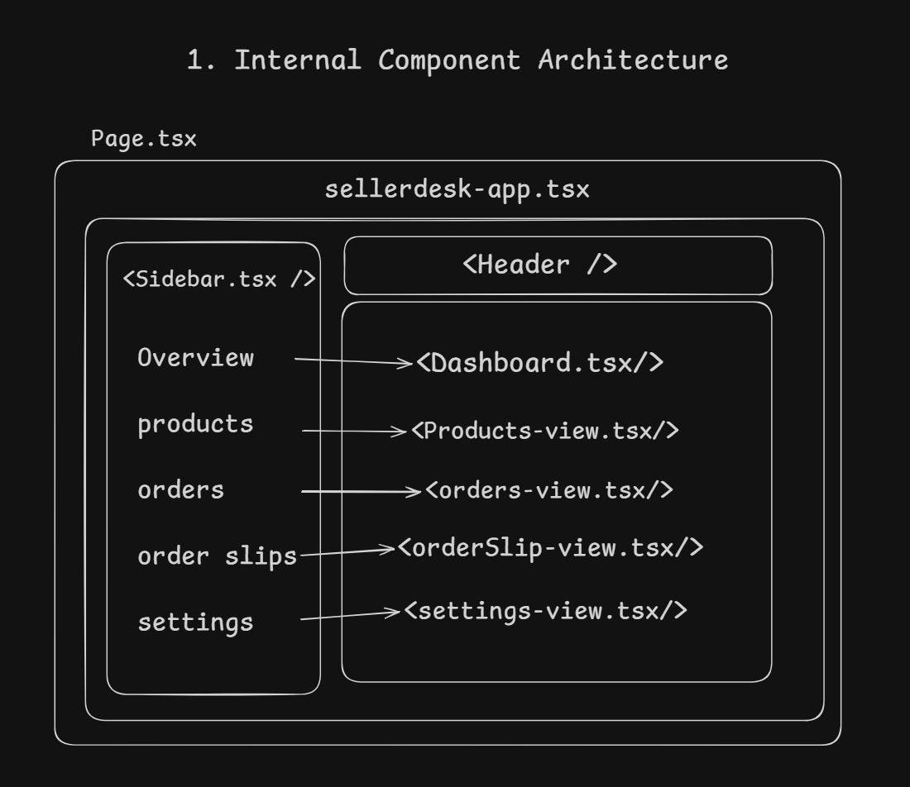
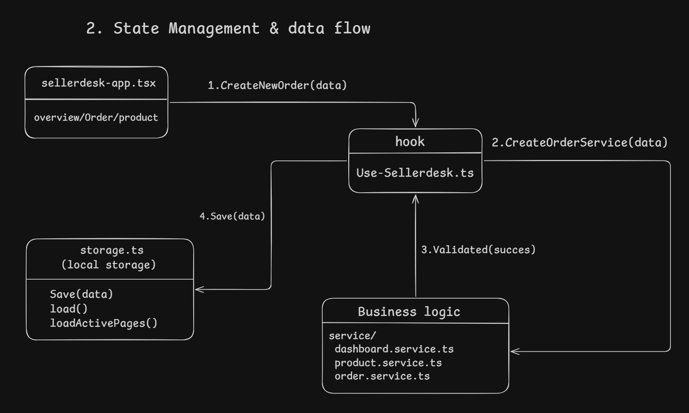

# SellerDesk 

SellerDesk is a lightweight workspace for small social-commerce sellers to manage products, inventory, customer orders, and order slips.

## Project context

The idea behind this project is to help small businesses that sell products through platforms like Facebook and Instagram. Many small sellers manage their orders through inbox or hand written notes. But As their businesses grow, tracking customer information, stock availability, and manage order status can become difficult.

So I wanted to build a simple software solution that could make these operations more organized and easier to manage.

## Features

- Dashboard with sales, order, profit, and low-stock summaries
- Product and inventory management
- Order creation and status updates, with stock adjustments when orders are confirmed or cancelled
- Configurable delivery charges for inside and outside Dhaka
- Printable order slips

## Tech stack

- Next.js 16 App Router, React 19, and TypeScript
- Tailwind CSS v4
- Local UI components using Base UI and Radix UI primitives
- Sonner for notifications

## Run locally
I used bun as the package manager for this project Beacause it is faster than npm. You can install bun from [https://bun.sh/](https://bun.sh/).

Requires Bun 1.4.2 or later.

```bash
bun install
bun run dev
```

Open [http://localhost:3000](http://localhost:3000). Use `bun run build` to create a production build and `bun run lint` to check the code.

## Project structure


```text
src/
|-- app/                    # Route entry, root layout, and global styles
|-- assets/images/          # Demo shop image
|-- components/
|   |-- dashboard/          # Dashboard view
|   |-- layout/             # Sidebar and header
|   |-- orders/             # Order views, dialogs, and slips
|   |-- products/           # Product list and editor
|   |-- settings/           # Delivery charge settings
|   |-- shared/             # Shared status and empty-state components
|   |-- ui/                 # Reusable UI primitives
|   `-- sellerdesk-app.tsx  # App shell and screen navigation
|-- hooks/
|   `-- use-sellerdesk.ts   # Shared state and app actions
|-- lib/
|   |-- dashboard.ts        # Dashboard calculations
|   |-- demo-data.ts        # Sample products and orders
|   |-- order-service.ts    # Order validation and status rules
|   |-- product-service.ts  # Product validation and updates
|   |-- storage.ts          # Browser persistence
|   |-- constants.ts        # Shared labels and defaults
|   `-- utils.ts            # Shared helpers
`-- types.ts                # Shared TypeScript types
```

## Here is main project components and their structure


## Here is the data flow and state management structure of the project



## How the workflow works

1. Add products and set their prices and stock.
2. Create an order with customer, delivery, and product details.
3. Confirm the order to reserve stock; mark it delivered when complete.
4. Cancel a confirmed order to return its stock to inventory.
5. View and print the order slip.

## Why localStorage?

Local storage keeps this application self-contained for an assignment demo: it needs no API, database, or account setup, while changes remain available after a browser refresh. Data is saved in the current browser profile only and is not shared between users or devices.

The first visit loads sample products and orders. To reset the demo, run this in the browser console:

```js
localStorage.removeItem("sellerdesk-data");
localStorage.removeItem("sellerdesk-active-page");
location.reload();
```

To view this project demo video [Click here](https://youtu.be/vmUukOgjhGE)

## Limitations

- There is no authentication, backend, or multi-user data isolation.
- Browser storage is suitable for this demo, not production data. A production app should validate stock changes on the server and persist them with database transactions.
- Dashboard profit is an estimate based on recorded product costs and selling prices; it excludes other operating costs.
